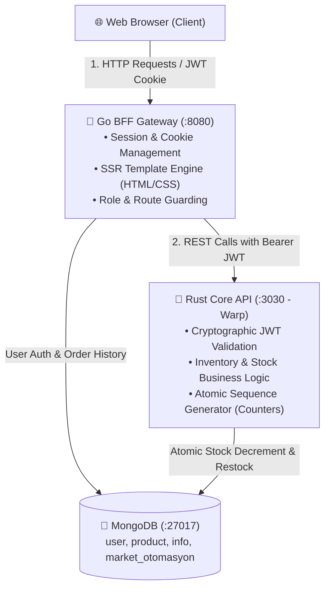

# 🛒 Stock & Market Automation System

[](https://golang.org)
[](https://www.rust-lang.org)
[](https://www.mongodb.com)
[](https://www.docker.com)
[]()
[]()

A polyglot distributed inventory and retail automation system developed during my **3rd-year university software engineering internship at Sanlab**. The project combines a **Go BFF (Backend-For-Frontend) Gateway** and a **Rust Core REST API** running alongside **MongoDB**.

---

## 📌 Project Background & Motivation

During my internship, rather than building a standard monolithic single-language CRUD app, I wanted to explore how real-world distributed architectures handle multi-language microservices, stateless security, and strict data consistency:

* **Go Layer (Port `:8080`):** Acts as an **API Gateway & BFF**. It handles client HTTP traffic, manages session tokens (JWT cookies), renders Server-Side (SSR) HTML templates, and enforces Role-Based Access Control (RBAC). Go's lightweight concurrency (Goroutines) and rapid I/O make it ideal for this edge role.
* **Rust Layer (Port `:3030`):** Operates as the **Core Domain Microservice** using the high-performance **Warp** web framework. It manages critical inventory operations, atomic stock decrements, sequence counters, and inventory health. Rust was chosen for its memory safety, zero-cost abstractions, and deterministic execution without garbage collector pauses.
* **MongoDB:** Serves as the persistence layer across segmented databases (`user`, `product`, `info`, and `market_otomasyon`), ensuring fast lookups and atomic document updates.

---

## 🏗️ System Architecture

The following diagram illustrates the end-to-end request lifecycle and authentication boundary:



---

## ✨ Key Features

### 1. 🔐 Role-Based Access Control (RBAC) & Super Key Concept
- Supports two primary roles: **Superuser (Admin)** and **Normal User**.
- Registration form (`/register`) includes an optional **Super Key (`super123`)** field:
  - Entering the key automatically grants administrative privileges.
  - Leaving it blank creates a standard customer account.
- Authentication utilizes HMAC-SHA256 JWT tokens created by Go and cryptographically verified by Rust's authentication filter for seamless cross-service authorization.

### 2. 🛍️ Real-Time Product Catalog & Atomic Order Flow
- Users can browse the catalog and place orders via `🛒 1 Adet Al`.
- Go dispatches the order to Rust (`POST /order_product/:id`).
- Rust atomically decrements the stock (`miktar - 1`) and automatically transitions the product status to `Tükendi (Out of Stock)` when inventory hits zero.
- Confirmed orders are stored in the MongoDB `orders` collection with timestamps and status tracking.

### 3. ⚠️ Critical Stock Alerts & Quick Admin Restock (+10)
- Products with remaining stock $\le 3$ display a glowing `⚠️ Kritik (X Adet)` badge.
- Out-of-stock items display a `⛔ Tükendi` badge and disable purchase buttons.
- Admins have access to a quick-action `+10 Stok` button that triggers Rust's `/restock_product/:id` endpoint to instantly replenishment inventory.

### 4. 📊 Dynamic KPI Dashboard & Order History
- Live metric cards tracking:
  - *Total Users*, *Total Products*, *In-Stock Count*, *Active Branches*, and *Total Orders*.
- Normal users can view their personal **"Son Siparişlerim (Order History)"** table.
- Admins have real-time visibility over system-wide customer order activities.

### 5. 🌓 Dark & Light Mode
- Clean, eye-friendly Dark Mode built with native CSS custom properties (`--bg-primary`, `--card-bg`, etc.).
- Persists user preferences seamlessly across all views (Dashboard, Catalog, CRUD forms) via `localStorage` without page-flicker.

---

## 💡 Architecture Decisions & Technical FAQ

<details>
<summary><b>1. Why use both Go and Rust in the same application?</b></summary>

> Go is exceptional at networking, concurrent I/O, and fast HTTP routing, making it an outstanding front-facing API Gateway and BFF. Rust, on the other hand, provides compile-time memory safety, zero-cost abstractions, and predictable latency without garbage collection stops. By delegating inventory transactions and counter generation to Rust while letting Go handle client traffic and HTML presentation, the system demonstrates the strengths of a polyglot microservice architecture.
</details>

<details>
<summary><b>2. How is cross-service security handled without a shared database session?</b></summary>

> Both services share a symmetric secret key (`JWT_SECRET_KEY`). When a user authenticates in Go, a signed JWT containing their `username` and `role` is generated and returned via an `HttpOnly` cookie. Whenever Go needs to interact with Rust, it extracts the token and includes it in the `Authorization: Bearer <token>` header. Rust's Warp filter decodes and validates the claims, ensuring that only authorized roles can invoke protected endpoints.
</details>

<details>
<summary><b>3. How are sequential IDs generated in MongoDB?</b></summary>

> Instead of exposing raw 24-character hex `ObjectId` strings to users, the system implements a sequence counter pattern stored in `market_otomasyon.counters`. Both Go and Rust invoke `FindOneAndUpdate` with `$inc: { "seq": 1 }` to produce safe, sequential IDs (`1, 2, 3...`) in an atomic operation.
</details>

---

## 🚀 Getting Started

### Prerequisites
- **Go:** `1.22+`
- **Rust & Cargo:** `1.80+`
- **MongoDB:** `localhost:27017` (or via Docker)

### 1. Quick Start (Recommended)
Use the included startup script to launch both Go and Rust with a single command:

```bash
chmod +x run.sh
./run.sh
```
*or using Makefile:*
```bash
make run
```

- **Go Web UI:** `http://localhost:8080`
- **Rust Core API:** `http://localhost:3030`

---

### 2. Running with Docker Compose
To run the entire polyglot stack inside isolated containers:

```bash
docker compose up --build -d
```
*To stop the containers:*
```bash
docker compose down
```

---

### 3. Running Unit Tests
Execute the automated test suites for both Go and Rust:

```bash
make test
```
*Runs Go unit tests (password hashing, Super Key checks, JWT claims) and Rust tests (product serialization, stock depletion).*

---

## 🔑 Default Credentials

The database comes pre-seeded with initial records:

| Role | Username | Password | Privileges |
| :--- | :--- | :--- | :--- |
| **Admin (Superuser)** | `admin` | `1234` | Full CRUD operations, quick restock (+10), all orders visibility |
| **Normal User** | Register at `/register` | Custom | Browse product catalog, place orders, personal order history |
| **Admin Super Key** | `super123` | — | Grants Superuser privileges during registration |

---

## 📁 Repository Structure

```text
stok_otomasyon/
├── main.go                       # Go BFF Server Entrypoint (:8080)
├── run.sh                        # Automation script to run Go + Rust concurrently
├── Makefile                      # Targets for run, test, and docker-up
├── Dockerfile                    # Multi-stage Dockerfile for Go
├── docker-compose.yml            # Go + Rust + MongoDB orchestration
│
├── controllers/                  # Go HTTP Handlers (Auth, CRUD, Orders)
│   └── auth_controller_test.go   # Go Unit Tests
├── middleware/                   # JWT & RBAC Route Protection Middleware
├── models/                       # Go Data Models (User, Product, Info, Order)
├── routes/                       # Web & API Route Registration
├── static/                       # CSS Variables, Dark Mode & Asset Files
├── templates/                    # Go HTML Templates (Dashboards, Catalog, CRUD)
│
└── backend-rust/                 # Rust Core REST API (:3030)
    ├── Cargo.toml                # Rust Dependencies
    ├── Dockerfile                # Multi-stage Dockerfile for Rust
    └── src/
        ├── main.rs               # Rust API Entrypoint & Warp HTTP Server
        ├── auth_middleware.rs    # JWT Bearer Token Validation Filter
        ├── handlers/             # Product, User, and Info REST Handlers
        ├── models/               # Rust Structs & Embedded Unit Tests
        ├── services/             # Atomic Sequence Counter Service
        └── db/                   # MongoDB Client Connection
```

---

## 👨‍💻 Author

**Ulaş Dursun**  
*Computer Engineering Student*  
GitHub: [@Ulas-Dursun](https://github.com/Ulas-Dursun)

*Special thanks to my internship mentors and the Sanlab engineering team for their guidance.*
