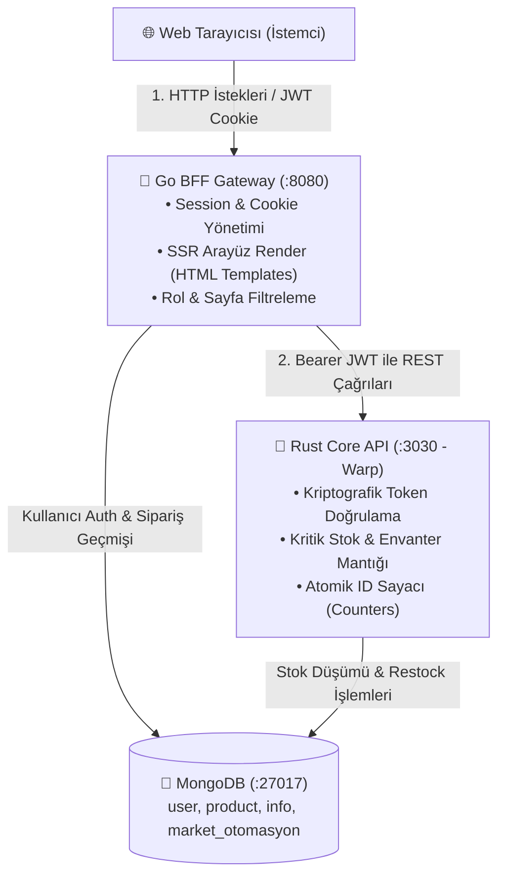

# 🛒 Stok & Market Otomasyon Sistemi

[](https://golang.org)
[](https://www.rust-lang.org)
[](https://www.mongodb.com)
[](https://www.docker.com)
[]()
[]()

Üniversite 3. sınıf stajım süresince geliştirdiğim; **Go (BFF - Backend-For-Frontend)** ve **Rust (Core REST API)** servislerinin birlikte çalıştığı, **MongoDB** tabanlı modern bir stok ve market otomasyon projesidir.

---

## 📌 Projenin Amacı & Staj Hikayesi

Staj dönemimde şirketin (Sanlab) teknoloji yığınındaki farklı sistemleri deneyimlerken klasik monolitik tek-dil yaklaşımı yerine; **mikroservis mimarisini**, **poliglot (çok dilli) servis iletişimini** ve **durumsuz (stateless) kimlik doğrulamasını** pratiğe dökmeyi hedefledim:

* **Go Katmanı (Port `:8080`):** Yüksek I/O hızı, goroutine tabanlı eşzamanlılık ve pratik şablon motoruyla istemciyi karşılayan, oturum (JWT Cookie) ve arayüz yönetimini üstlenen bir **API Gateway / BFF** olarak konumlandı.
* **Rust Katmanı (Port `:3030`):** Bellek güvenliği (memory safety), sıfır çöp toplayıcı (zero-GC) gecikmesi ve veri tutarlılığı gerektiren kritik envanter, stok düşümü ve sayaç transaksiyonlarını yöneten yüksek performanslı bir **Core REST API (Warp)** servisi olarak geliştirildi.
* **MongoDB:** Ayrık koleksiyon yapısı (`user_db`, `product_db`, `info_db`, `counters`, `orders`) ile sistem verilerini esnek ve hızlı bir biçimde saklamak için kullanıldı.

---

## 🏗️ Sistem Mimarisi

İstemciden veritabanına uzanan istek ve yetkilendirme akışı:



---

## ✨ Öne Çıkan Özellikler

### 1. 🔐 Rol Tabanlı Yetkilendirme (RBAC) & Super Key Mekanizması
- Sistemde **Superuser (Admin)** ve **Normal Kullanıcı** olmak üzere 2 farklı rol bulunur.
- Kayıt olurken (`/register`) gizli **Super Key (`super123`)** giren kişiler doğrudan Superuser yetkisiyle açılır; girmeyenler ise standart müşteri/kullanıcı olur.
- Go tarafında üretilen HMAC-SHA256 imzalı JWT token'lar, Rust Core API tarafından çözülüp doğrulanarak servisler arası uçtan uca yetki kontrolü sağlanır.

### 2. 🛍️ Ürün Kataloğu & Anlık Stoktan Düşüm (Order Flow)
- Kullanıcılar katalogdaki ürünleri inceler ve tek tıkla `🛒 1 Adet Al` diyerek sipariş verebilir.
- İstek Go üzerinden Rust'a aktarılır; Rust atomik olarak ürün stoğunu `1` azaltır ve stok bittiğinde ürünü otomatik olarak `Tükendi` moduna alır.
- Başarılı siparişler kullanıcının ve sistemin **Sipariş Geçmişi** tablosuna tarih ve durum bilgisiyle işlenir.

### 3. ⚠️ Kritik Stok Uyarısı & Hızlı Stok Ekleme (+10)
- Stoğu $\le 3$ olan ürünlerin yanında parlayan turuncu `⚠️ Kritik Stok` rozeti çıkar.
- Yöneticiler için her ürün satırında `+10 Stok` butonu bulunur; yönetici tek tıkla Rust REST API üzerinden ürüne 10 adet stok ekleyebilir.

### 4. 📊 Dinamik KPI Dashboard & İstatistikler
- MongoDB üzerindeki canlı verilerle beslenen istatistik kartları:
  - *Toplam Kullanıcı*, *Toplam Ürün*, *Stoktaki Ürünler*, *Hizmet Veren Şubeler*, *Sipariş Sayısı*.
- Normal kullanıcılar kendi verdikleri son siparişleri, yöneticiler ise sistem genelindeki tüm sipariş hareketlerini anlık takip edebilir.

### 5. 🌓 Gece / Gündüz Modu (Dark & Light Theme)
- Tüm sayfalarda (Giriş, Kayıt, Dashboard'lar ve CRUD ekranları) çalışan, `localStorage` üzerinde kullanıcının tercihini hatırlayan kesintisiz Dark Mode desteği.

---

## 💡 Mülakat Notları & Sıkça Sorulan Sorular

Mülakatlarda bu projeyle ilgili gelebilecek sorulara yaklaşımım:

<details>
<summary><b>1. Neden Go ve Rust dillerini aynı projede birleştirdin?</b></summary>

> Go, standart kütüphanesindeki zengin `net/http` paketi, hızlı goroutine çalışma zamanı ve SSR şablon desteği sayesinde harika bir API Gateway / BFF aracıdır. Diğer yanda Rust; sahiplik (ownership) modeli, derleme zamanı bellek garantileri ve deterministik performansı ile finans veya envanter gibi *"veri kaybına / yarış durumuna (race condition) tahammülü olmayan"* kritik iş mantıklarını işletmek için idealdir. Stajımda bu iki gücü tek mimaride birleştirmeyi hedefledim.
</details>

<details>
<summary><b>2. İki servis arasında kimlik doğrulaması nasıl yapılıyor?</b></summary>

> İki servis ortak bir simetrik anahtar (`JWT_SECRET_KEY`) paylaşır. Kullanıcı Go üzerinden giriş yaptığında SHA-256 ile şifre doğrulanır ve Go tarafından bir JWT üretilir. Go, Rust servisine HTTP çağrısı yaparken bu token'ı `Authorization: Bearer <token>` başlığıyla iletir. Rust katmanında yazdığım Warp filter middleware'i bu token'ı doğrular ve kullanıcının rolünü (`superuser` / `normal`) çözerek yetki kontrolünü servis seviyesinde yapar.
</details>

<details>
<summary><b>3. MongoDB'de ID yönetimini nasıl sağladınız?</b></summary>

> Klasik MongoDB `ObjectId` string'leri yerine kullanıcı dostu sıralı ID'ler üretmek adına `market_otomasyon.counters` koleksiyonu kullandık. Hem Go hem Rust tarafında `FindOneAndUpdate` ile `$inc: {seq: 1}` çalıştırılarak atomik sıralı ID üretimi sağlandı.
</details>

---

## 🚀 Kurulum & Çalıştırma

### Gereksinimler
- **Go:** `1.22+`
- **Rust & Cargo:** `1.80+`
- **MongoDB:** `localhost:27017` (veya Docker)

### 1. Hızlı Başlatma (Tavsiye Edilen)
Proje kök dizinindeki başlatma betiği hem Go hem Rust servislerini derleyip otomatik başlatır:

```bash
chmod +x run.sh
./run.sh
```
*veya alternatif olarak:*
```bash
make run
```

* Go Arayüzü: `http://localhost:8080`
* Rust Core API: `http://localhost:3030`

---

### 2. Docker Compose ile Başlatma
Sistemde Go veya Rust kurulu olmadan doğrudan konteynerler üzerinden çalıştırmak için:

```bash
docker compose up --build -d
```
*Durdurmak için:*
```bash
docker compose down
```

---

### 3. Testleri Çalıştırma
Projeye eklediğimiz birim testleri (şifre hashleme, Super Key denetimi, JWT oluşturma, ürün serileştirme ve stok tükenme simülasyonu) tek komutla koşabilirsiniz:

```bash
make test
```

---

## 🔑 Varsayılan Giriş & Test Bilgileri

Sistemi hemen deneyebilmeniz için veritabanında hazır bulunan kullanıcı bilgileri:

| Rol | Kullanıcı Adı | Şifre | Yetki Kapsamı |
| :--- | :--- | :--- | :--- |
| **Yönetici (Superuser)** | `admin` | `1234` | Tüm kullanıcı, ürün ve şube CRUD işlemleri, hızlı stok ekleme, tüm siparişleri görme |
| **Normal Kullanıcı** | `/register` sayfasından açılabilir | Belirleyeceğiniz şifre | Ürün kataloğunu görme, sipariş verme, kendi sipariş geçmişini inceleme |
| **Yönetici Kayıt Anahtarı** | `super123` | *(Kayıt esnasında girilirse hesabı Admin yapar)* |

---

## 📁 Proje Dizin Yapısı

```text
stok-otomasyon/
├── main.go                       # Go BFF Sunucu Giriş Noktası (:8080)
├── run.sh                        # Tek tıkla Go ve Rust'ı başlatan betik
├── Makefile                      # make run, make test, make docker-up komutları
├── Dockerfile                    # Go için çok aşamalı (multi-stage) Dockerfile
├── docker-compose.yml            # Go + Rust + MongoDB orkestrasyonu
│
├── controllers/                  # Go HTTP İstek Yöneticileri (Auth, CRUD, Sipariş)
│   └── auth_controller_test.go   # Go Birim Testleri
├── middleware/                   # JWT & Rol Tabanlı Erişim Kontrolü (RBAC)
├── models/                       # Go Veri Modelleri (User, Product, Info, Order)
├── routes/                       # Go Web ve API Rota Tanımları
├── static/                       # CSS, Gece/Gündüz Teması ve Tasarım Dosyaları
├── templates/                    # Go HTML Şablonları (Dashboard, CRUD Ekranları)
│
└── backend-rust/                 # Rust Warp Core REST API (:3030)
    ├── Cargo.toml                # Rust Paket Bağımlılıkları
    ├── Dockerfile                # Rust için çok aşamalı Dockerfile
    └── src/
        ├── main.rs               # Rust API Giriş Noktası & Warp Server
        ├── auth_middleware.rs    # JWT Bearer Token Doğrulayıcı Filter
        ├── handlers/             # Ürün, Kullanıcı ve Şube REST Handler'ları
        ├── models/               # Rust Struct Modelleri & Unit Testler
        ├── services/             # Sıralı Sayaç (Counter) Servisi
        └── db/                   # MongoDB İstemci Bağlantısı
```

---

## 👨‍💻 Geliştirici

**Ulaş Dursun**  
*Bilgisayar Mühendisliği Öğrencisi*  
GitHub: [@Ulas-Dursun](https://github.com/Ulas-Dursun)

*Staj çalışmam süresince bana yol gösteren mentorlerime ve Sanlab ekibine teşekkür ederim.*
