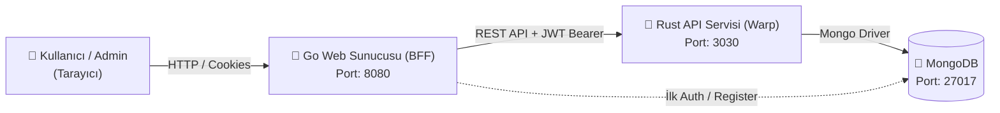

# 🛒 Market & Stok Otomasyon Sistemi (Polyglot Mikroservis Mimarisi)

Bu proje, bir üniversite 3. sınıf staj çalışması kapsamında geliştirilmiş; modern sistem mimarilerini (BFF - Backend-for-Frontend, RESTful API, Rol Tabanlı Erişim Kontrolü - RBAC ve NoSQL veri tabanı) pratiğe döken **çok dilli (Rust + Go)** bir stok ve market otomasyon sistemidir.

---

## 📌 Mimari Genel Bakış

Projede iki farklı dil ve çalışma zamanı (runtime) bir arada kullanılmıştır:

1. **Frontend & API Gateway / BFF (Go - Port `:8080`):**
   * Kullanıcı arayüzünü (HTML/CSS) Server-Side Rendering (SSR) ile sunar.
   * Kullanıcı kimlik doğrulamasını (Login/Register) ve JWT token yönetimini yürütür.
   * Formlardan gelen istekleri arkadaki Rust API servisine yetkilendirilmiş (`Authorization: Bearer <token>`) HTTP çağrıları olarak iletir.

2. **Core Backend & Data Service (Rust / Warp - Port `:3030`):**
   * Tip güvenliği (type-safety) ve bellek güvenliği (memory-safety) yüksek Warp web framework'ü üzerinde çalışan yüksek performanslı REST API'dir.
   * Gelen JWT token'ları decode ederek rol doğrulaması (`superuser` / `normal`) yapar.
   * Sıralı ID sayacı (Atomic Counter) ve MongoDB CRUD işlemlerini yönetir.

3. **Veritabanı (MongoDB - Port `:27017`):**
   * Kullanıcılar, ürünler, şube bilgileri ve otomatik artan ID sayaçlarını barındırır.



---

## 🔑 Öne Çıkan Özellikler

* **🔐 JWT Tabanlı Kimlik Doğrulama (RBAC):** `superuser` (Yönetici) ve `normal` (Standart kullanıcı) rolleri ile endpoint düzeyinde erişim kontrolü.
* **🗝️ Super Key (Yönetici Anahtarı) Mekanizması:** Kayıt formunda (`/register`) gizli `SUPER_KEY` girildiğinde otomatik olarak yönetici hesabı oluşturulur; girilmediğinde standart kullanıcı açılır.
* **📦 Ürün & Stok Yönetimi:** Ürün ekleme, silme, stok/satış durumu güncelleme ve liste görünümü.
* **👥 Kullanıcı Yönetimi:** Kullanıcı bilgilerini listeleme, rol atama ve güvenli şifreleme (SHA-256).
* **🏢 Şube / İletişim Bilgileri Yönetimi:** Şube adresleri, telefon ve personel sayısı CRUD işlemleri.
* **🎨 Modern & Responsive Arayüz:** Modern kart tasarımı, rozetler (badges) ve responsive tablolar ile temiz kullanıcı deneyimi.

---

## 📂 Proje Dizin Yapısı

```text
stok_otomasyon/
├── Cargo.toml                  # Rust bağımlılıkları (Warp, Tokio, MongoDB, JWT, Serde)
├── src/                        # Rust Backend kaynak kodları
│   ├── main.rs                 # Warp REST API sunucusu & rota tanımları (:3030)
│   ├── auth_middleware.rs      # JWT doğrulama ve RBAC filtreleri
│   ├── handlers/               # Product, User, Info route handler'ları
│   ├── models/                 # Veri yapıları (Serde User, Product, Info, Counter)
│   ├── db/                     # MongoDB bağlantı istemcisi
│   └── services/               # Sıralı ID sayacı (Sequence counter) servisi
├── frontend-go/                # Go Frontend / BFF kaynak kodları
│   ├── main.go                 # Go HTTP sunucusu & veritabanı başlatıcı (:8080)
│   ├── controllers/            # Auth ve CRUD controller'ları (Rust API çağrıları)
│   ├── middleware/             # Go JWT ve Rol kontrol middleware'leri
│   ├── models/                 # Go veri modelleri & DB bağlantısı
│   ├── routes/                 # Web rotaları & endpoint eşleştirmeleri
│   ├── static/css/styles.css   # Modern, responsive arayüz stilleri
│   └── templates/              # HTML şablonları (Dashboard, Login, Register, CRUD)
├── .env.example                # Örnek ortam değişkenleri şablonu
├── .gitignore                  # Git dışlama kuralları
└── README.md                   # Proje dokümantasyonu
```

---

## 🚀 Kurulum ve Çalıştırma

### Gereksinimler
* [Rust](https://www.rust-lang.org/) (1.70+ önerilir)
* [Go](https://go.dev/) (1.20+ önerilir)
* [MongoDB](https://www.mongodb.com/) (Yerel `localhost:27017` veya Docker)

### 1. MongoDB'yi Başlatın
Yerel MongoDB servisinizi başlatın veya Docker ile çalıştırın:
```bash
docker run -d -p 27017:27017 --name mongodb mongo:latest
```

### 2. Ortam Değişkenlerini Ayarlayın
Kök dizindeki `.env.example` dosyasını `.env` olarak kopyalayın:
```bash
cp .env.example .env
```
Varsayılan değerler:
```env
JWT_SECRET_KEY=your_secret_key
SUPER_KEY=super123
MONGODB_URI=mongodb://localhost:27017
RUST_API_URL=http://localhost:3030
PORT=8080
```

### 3. Rust Backend Servisini Başlatın
Terminal 1:
```bash
# Kök dizinde:
cargo run
```
*API servisi `http://127.0.0.1:3030` adresinde dinlemeye başlayacaktır.*

### 4. Go Frontend / Web Sunucusunu Başlatın
Terminal 2:
```bash
cd frontend-go
go run main.go
```
*Web uygulaması `http://localhost:8080` adresinde çalışacaktır.*

Tarayıcınızdan **`http://localhost:8080`** adresine giderek uygulamayı kullanmaya başlayabilirsiniz!

---

## 🔐 Super Key ile Yönetici Hesabı Oluşturma

1. Tarayıcıdan `/register` sayfasına gidin.
2. Ad, soyad, kullanıcı adı ve şifrenizi girin.
3. **Super Key** alanına `.env` dosyasındaki anahtarı (**`super123`**) girin.
4. Kayıt tamamlandığında hesabınız **Superuser (Admin)** olarak açılacak ve doğrudan `/admin/dashboard` sayfasına yönlendirileceksiniz.
5. Super Key alanını boş bırakırsanız standart kullanıcı olarak kaydedilirsiniz.

---

## 📡 REST API Endpoint Özeti (Rust - :3030)

| Metod | Endpoint | Yetki Seviyesi | Açıklama |
| :--- | :--- | :--- | :--- |
| `POST` | `/add_user` | `superuser` | Yeni kullanıcı oluşturur ve sıralı ID atar. |
| `GET` | `/list_users` | `superuser` | Kayıtlı kullanıcıları listeler. |
| `PUT` | `/update_user/:id` | `superuser` | Kullanıcı bilgilerini günceller. |
| `DELETE` | `/delete_user/:id` | `superuser` | Kullanıcıyı siler. |
| `POST` | `/add_product` | `superuser` | Yeni ürün kaydeder. |
| `GET` | `/list_products` | `normal` / `superuser` | Ürün kataloğunu listeler. |
| `PUT` | `/update_product/:id` | `superuser` | Ürün bilgilerini günceller. |
| `DELETE` | `/delete_product/:id` | `superuser` | Ürünü siler. |
| `POST` | `/add_info` | `superuser` | Şube/iletişim bilgisi ekler. |
| `GET` | `/list_info` | `normal` / `superuser` | Şube bilgilerini listeler. |
| `PUT` | `/update_info/:id` | `superuser` | Şube bilgisini günceller. |
| `DELETE` | `/delete_info/:id` | `superuser` | Şube bilgisini siler. |

---

## 💡 Staj ve Tasarım Notları: Neden Rust ve Go Birleşimi?

> *"Neden iki farklı dil kullandınız?"* sorusunun cevabı:

Gerçek dünya simülasyon, donanım/robotik ve IoT şirketlerinde (örneğin **Sanlab** gibi kurumlarda):
* **Rust:** Donanım seviyesine yakın çalışma, sıfır maliyetli soyutlama (zero-cost abstractions), deterministik bellek yönetimi (garbage collector olmaması) ve yüksek işlem hızı gerektiren kritik veri servisleri için tercih edilir.
* **Go:** Ağ programlama, hızlı HTTP/I/O eşzamanlılığı (goroutine'ler), API Gateway / BFF katmanları ve şablon renderlama operasyonlarında yüksek geliştirme hızı sunduğu için tercih edilir.

Bu projede **Backend-for-Frontend (BFF)** mimari deseni uygulanarak iki dilin en güçlü yönleri tek bir sistemde buluşturulmuştur.
